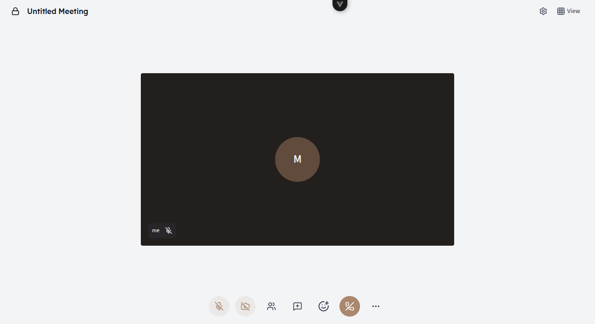
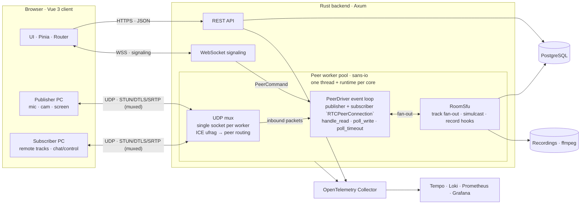

<a id="readme-top"></a>

<div align="center">
  <h1>Orvix</h1>

  <p>
    A self-hosted video conferencing platform built on a custom Rust SFU and a Vue 3 client.
    <br />
    Own your meetings, your media, and your data.
  </p>

  <p>
    <a href="docs/md/index.md"><strong>Read the Docs</strong></a>
    &middot;
    <a href="https://github.com/marfanr/vidcall/issues/new?labels=bug"><strong>Report Bug</strong></a>
    &middot;
    <a href="https://github.com/marfanr/vidcall/issues/new?labels=enhancement"><strong>Request Feature</strong></a>
  </p>

  
  
  

  <br /><br />

  
  
  
  
  
  
  
  
</div>

<br />

<div align="center">
  
</div>

## About

**Orvix** (repository: **VidCall**) is a self-hosted video conferencing system for teams that want full control over their meetings. A Rust backend with a purpose-built Selective Forwarding Unit (SFU) handles WebRTC media, authentication, and rooms, while a Vue 3 frontend provides the meeting experience. Media flows through your own infrastructure, with no third-party service involved.

## Features

- **Video & audio:** multi-party calls through a custom sans-io Rust SFU with simulcast-aware forwarding.
- **Meeting rooms:** aliases, optional passcodes, custom titles, and a waiting room with join requests.
- **In-call tools:** chat, emoji reactions, screen sharing, member list, and per-device media configuration.
- **Authentication:** JWT access tokens with rotating refresh tokens and reuse detection.
- **Recording:** server-side recording to disk (requires `ffmpeg`).
- **AI experiments:** local ONNX text-to-speech, speech-to-text, and background filters.
- **Observability:** OpenTelemetry, Prometheus, Loki, Tempo, and provisioned Grafana dashboards.

## Architecture



For SFU internals, API reference, data models, and the full environment variable list, see the [documentation](docs/md/index.md).

<p align="right">(<a href="#readme-top">back to top</a>)</p>

## Getting Started

### Prerequisites

- Rust 1.85+
- Bun 1.2+ (or Node.js 22.18+ / 24.12+)
- Docker and Docker Compose
- OpenSSL
- FFmpeg (optional, for recording)

### Installation

1. Clone the repository:

   ```sh
   git clone git@github.com:marfanr/vidcall.git
   cd vidcall
   ```

2. Generate TLS certificates and the base environment file:

   ```sh
   cd backend
   ./setup_certs.sh
   ```

3. Add the JWT secrets to `backend/.env` (each at least 32 bytes, and different from each other):

   ```sh
   openssl rand -base64 48   # JWT_ACCESS_SECRET
   openssl rand -base64 48   # JWT_REFRESH_SECRET
   ```

   Also set `POSTGRES_PASSWORD`. All other variables have defaults; see the [docs](docs/md/index.md) for the full list.

4. Start PostgreSQL (and optionally the observability stack):

   ```sh
   docker compose up -d etcd postgres

   # Optional
   docker compose up -d otel-collector tempo loki prometheus grafana
   ```

5. Create a `vidcall` database and apply [`backend/migrations/01-init.sql`](backend/migrations/01-init.sql).

   > Migration files are still being consolidated. Verify the tables referenced in [`backend/src/models/constant.rs`](backend/src/models/constant.rs) before starting the backend.

### Run

```sh
# backend (http://localhost:8080)
cd backend && cargo run

# frontend (http://localhost:5173)
cd frontend && bun install && bun dev
```

<p align="right">(<a href="#readme-top">back to top</a>)</p>

## Roadmap

- [x] Multi-party WebRTC SFU
- [x] JWT authentication with rotating refresh tokens
- [x] Waiting room and join requests
- [x] Chat, reactions, and screen sharing
- [x] Server-side recording
- [ ] Consolidated, automated database migrations
- [ ] End-to-end encrypted media
- [ ] Horizontal SFU scaling for large rooms
- [ ] Production deployment guides and Helm charts

See the [open issues](https://github.com/marfanr/vidcall/issues) for proposed features and known issues.

## Contributing

Contributions are welcome. Fork the project, create a feature branch, and open a pull request. Before submitting, run:

```sh
# frontend
cd frontend && bun run type-check && bun run lint

# backend
cd backend && cargo fmt --check && cargo clippy --all-targets -- -D warnings && cargo test
```

## License

Distributed under the **GNU Affero General Public License v3.0 (AGPL-3.0)**. See [`LICENSE`](LICENSE) for details.

## Acknowledgments

[webrtc-rs/rtc](https://github.com/webrtc-rs/rtc), [Axum](https://github.com/tokio-rs/axum) and Tokio, [Vue.js](https://vuejs.org/), [OpenTelemetry](https://opentelemetry.io/), [Grafana](https://grafana.com/), [ONNX Runtime](https://onnxruntime.ai/), [MediaPipe](https://developers.google.com/mediapipe), and [Best-README-Template](https://github.com/othneildrew/Best-README-Template).

<p align="right">(<a href="#readme-top">back to top</a>)</p>