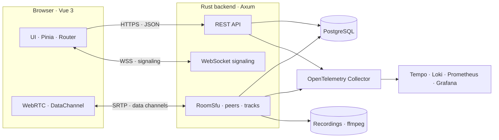

<a id="readme-top"></a>

<!-- PROJECT SHIELDS -->
[![Contributors][contributors-shield]][contributors-url]
[![Forks][forks-shield]][forks-url]
[![Stargazers][stars-shield]][stars-url]
[![Issues][issues-shield]][issues-url]
[![License][license-shield]][license-url]

<br />

<!-- PROJECT HEADER -->
<div align="center">
  <h1 align="center">Orvix</h1>

  <p align="center">
    A self-hosted video conferencing platform built on a custom Rust SFU and a modern Vue 3 client.
    <br />
    Own your meetings, your media, and your data.
    <br />
    <br />
    <a href="https://github.com/marfanr/vidcall/issues/new?labels=bug"><strong>Report Bug</strong></a>
    &middot;
    <a href="https://github.com/marfanr/vidcall/issues/new?labels=enhancement"><strong>Request Feature</strong></a>
    &middot;
    <a href="docs/md/index.md"><strong>Read the Docs</strong></a>
  </p>
</div>

<br />

<!-- TECH STACK SHIELDS -->
<div align="center">
  
  
  
  
  
  
  
  
  
  
  
  
</div>

<br />

<!-- TABLE OF CONTENTS -->
<details>
  <summary>Table of Contents</summary>
  <ol>
    <li>
      <a href="#about-the-project">About The Project</a>
      <ul>
        <li><a href="#features">Features</a></li>
        <li><a href="#built-with">Built With</a></li>
      </ul>
    </li>
    <li><a href="#architecture">Architecture</a></li>
    <li>
      <a href="#getting-started">Getting Started</a>
      <ul>
        <li><a href="#prerequisites">Prerequisites</a></li>
        <li><a href="#installation">Installation</a></li>
        <li><a href="#environment-variables">Environment Variables</a></li>
        <li><a href="#running-the-app">Running the App</a></li>
      </ul>
    </li>
    <li><a href="#usage">Usage</a></li>
    <li><a href="#api-surface">API Surface</a></li>
    <li><a href="#project-structure">Project Structure</a></li>
    <li><a href="#observability">Observability</a></li>
    <li><a href="#documentation">Documentation</a></li>
    <li><a href="#roadmap">Roadmap</a></li>
    <li><a href="#contributing">Contributing</a></li>
    <li><a href="#license">License</a></li>
    <li><a href="#contact">Contact</a></li>
    <li><a href="#acknowledgments">Acknowledgments</a></li>
  </ol>
</details>

<!-- ABOUT THE PROJECT -->
## About The Project

**Orvix** (repository: **VidCall**) is a self-hosted video conferencing system for teams that want full control over their meetings. It pairs a high-performance Rust backend—including a purpose-built Selective Forwarding Unit (SFU)—with a reactive Vue 3 frontend, so media flows through your own infrastructure instead of a third-party service.

The backend handles WebRTC peer connections, media forwarding, authentication, room management, and telemetry. The frontend provides a polished meeting experience with device configuration, chat, reactions, screen sharing, and server-side recording.

### Features

| Area | Highlights |
| --- | --- |
| **Video & audio** | Multi-party WebRTC calls through a custom Rust SFU, simulcast-aware track forwarding, mute/unmute state sync, and automatic peer cleanup. |
| **Meeting rooms** | Room aliases, optional passcodes, custom titles, and a waiting-room flow with join requests. |
| **In-call experience** | Real-time chat over WebRTC data channels, emoji reactions, screen sharing, member list, new-message toasts, and per-device media configuration. |
| **Authentication** | JWT access tokens with rotating refresh tokens stored in an `httpOnly` cookie, token-family revocation, and refresh-token reuse detection. |
| **Recording** | Server-side recording pipeline that captures published tracks and writes them to disk (requires `ffmpeg`). |
| **AI experiments** | Local ONNX text-to-speech, speech-to-text, and MediaPipe-based background segmentation/filters. |
| **Observability** | OpenTelemetry traces, Prometheus metrics, Loki log shipping, Tempo traces, and provisioned Grafana dashboards. |
| **Self-hosted** | PostgreSQL + Docker Compose infrastructure, no external SaaS dependencies, AGPL-3.0 licensed. |

<p align="right">(<a href="#readme-top">back to top</a>)</p>

### Built With

#### Frontend

- [![Vue.js][vue-badge]][vue-url] 3 with the Composition API
- [![TypeScript][ts-badge]][ts-url]
- [![Vite][vite-badge]][vite-url]
- [![Tailwind CSS][tailwind-badge]][tailwind-url]
- [![Pinia][pinia-badge]][pinia-url]
- [Vue Router](https://router.vuejs.org/), [VeeValidate](https://vee-validate.logaretm.com/) + [Zod](https://zod.dev/)
- [Axios](https://axios-http.com/), [Lucide](https://lucide.dev/)

#### Backend

- [![Rust][rust-badge]][rust-url] (edition 2024)
- [![Axum][axum-badge]][axum-url] for HTTP and WebSocket endpoints
- [webrtc-rs](https://github.com/webrtc-rs/webrtc) for the SFU
- [![PostgreSQL][postgres-badge]][postgres-url] via `tokio-postgres` + `deadpool-postgres`
- `argon2` password hashing, `jsonwebtoken`, `sonic-rs`, `validator`
- `ort` (ONNX Runtime) for local AI inference

#### Infrastructure & Observability

- [![Docker][docker-badge]][docker-url] Compose with Spilo/PostgreSQL HA, etcd, OpenTelemetry Collector, Tempo, Loki, Prometheus, and Grafana
- [![OpenTelemetry][otel-badge]][otel-url] traces and metrics

<p align="right">(<a href="#readme-top">back to top</a>)</p>

<!-- ARCHITECTURE -->
## Architecture



The backend exposes four route groups under the same Axum server:

| Component | Responsibility |
| --- | --- |
| **API** | Registration, authentication, room creation/joining, metrics, health. |
| **WebSocket** | Initial signaling, SDP negotiation, join requests, and real-time events. |
| **SFU** | One publisher and one subscriber `PeerConnection` per participant, track fan-out, simulcast layers, and recording hooks. |
| **Models** | Typed PostgreSQL access for `users`, `refresh_tokens`, and `room`. |

<p align="right">(<a href="#readme-top">back to top</a>)</p>

<!-- GETTING STARTED -->
## Getting Started

Follow these steps to run Orvix locally with the bundled Docker Compose infrastructure.

### Prerequisites

- **Rust 1.85+** (the workspace uses edition 2024)
- **Bun 1.2+** or **Node.js 22.18+ / 24.12+** with npm
- **Docker** and **Docker Compose**
- **OpenSSL** (used by `backend/setup_certs.sh`)
- **FFmpeg** (optional, only for server-side recording)
- **PostgreSQL 18** (provided by the Compose stack via Spilo)

### Installation

1. **Clone the repository**

   ```sh
   git clone git@github.com:marfanr/vidcall.git
   cd vidcall
   ```

2. **Generate TLS certificates and the base environment file**

   ```sh
   cd backend
   ./setup_certs.sh
   ```

   This creates `backend/certs/` and writes `SSL_CERTIFICATE`, `SSL_PRIVATE_KEY`, and `PG_CA_CERT` into `backend/.env`.

3. **Add the remaining secrets to `backend/.env`**

   ```sh
   openssl rand -base64 48   # JWT_ACCESS_SECRET
   openssl rand -base64 48   # JWT_REFRESH_SECRET
   ```

   The two JWT secrets must be at least 32 bytes and must be different.

4. **Start PostgreSQL (and optionally the observability stack)**

   ```sh
   cd backend
   docker compose up -d etcd postgres

   # Optional: full telemetry stack
   docker compose up -d otel-collector tempo loki prometheus grafana
   ```

5. **Provision the database schema**

   Create a `vidcall` database and apply the schema in [`backend/migrations/01-init.sql`](backend/migrations/01-init.sql). The backend expects the `users`, `refresh_tokens`, and `room` tables; their canonical columns and queries live in [`backend/src/models/constant.rs`](backend/src/models/constant.rs).

   > The migration files are still being consolidated. Verify the tables referenced by the SQL constants before starting the backend.

<p align="right">(<a href="#readme-top">back to top</a>)</p>

### Running the App

1. **Run the backend**

   ```sh
   cd backend
   cargo run
   ```

   The API and WebSocket server listen on **`http://localhost:8080`** by default.

2. **Run the frontend**

   ```sh
   cd frontend
   bun install
   bun dev
   ```

   Open **`http://localhost:5173`**. The backend CORS configuration already allows `http://localhost:5173` and `http://127.0.0.1:5173`.

<p align="right">(<a href="#readme-top">back to top</a>)</p>

### Environment Variables

Configuration is loaded from `backend/.env` via `dotenvy`.

| Variable | Required | Default | Description |
| --- | :---: | --- | --- |
| `JWT_ACCESS_SECRET` | Yes | — | Access-token signing secret. Minimum 32 bytes. |
| `JWT_REFRESH_SECRET` | Yes | — | Refresh-token signing secret. Minimum 32 bytes and different from the access secret. |
| `POSTGRES_PASSWORD` | Yes | — | PostgreSQL password. |
| `POSTGRES_HOST` | | `localhost` | PostgreSQL host. |
| `POSTGRES_PORT` | | `5432` | PostgreSQL port. |
| `POSTGRES_DB` | | `vidcall` | Database name. |
| `POSTGRES_USER` | | `postgres` | Database user. |
| `POSTGRES_POOL_SIZE` | | `32` | Connection pool size. |
| `PG_CA_CERT` | | `certs/ca.crt` | CA certificate used to verify the database connection. |
| `SSL_CERTIFICATE` | | — | Server certificate injected by `setup_certs.sh`; used by the Spilo container. |
| `SSL_PRIVATE_KEY` | | — | Server private key injected by `setup_certs.sh`; used by the Spilo container. |
| `OTEL_EXPORTER_OTLP_ENDPOINT` | | `http://localhost:4317` | OTLP collector endpoint. |
| `OTEL_SERVICE_NAME` | | — | Service name reported to the telemetry pipeline. |
| `LOKI_ENDPOINT` | | `http://localhost:3100/loki/api/v1/push` | Loki push endpoint. |
| `LOG` | | `info,rtc_dtls=error,ort=warn` | `tracing` env-filter directive. |
| `PROMETHEUS_TOKEN` | | — | If set, `/metrics` requires `Authorization: Bearer <token>`. |
| `MODEL_DIR` | | `models/` | Directory containing local ONNX model assets. |
| `MODEL_FILE` | | `model.onnx` | ONNX model filename for TTS. |
| `ORT_OPT` | | `level1` | ONNX Runtime optimization level: `disable`, `level1`, `level2`, `level3`. |
| `RECORD_DIR` | | temp dir | Destination directory for recordings. |
| `RECORD_TEE_DIR` | | — | If set, also writes raw H.264 tee files to this directory. |

<p align="right">(<a href="#readme-top">back to top</a>)</p>

<!-- USAGE -->
## Usage

| Route | Access | Purpose |
| --- | --- | --- |
| `/` | Authenticated | Dashboard: start or schedule a meeting, browse recent meetings. |
| `/signup` | Public | Create an account and sign in automatically. |
| `/signin` | Public | Authenticate and obtain an access token. |
| `/meet/:id` | Public / passcode | Join a video call by room alias or ID. |
| `/:pathMatch(.*)*` | Public | Not-found page. |

A typical flow:

1. Create an account at `/signup`.
2. Start a new meeting from the dashboard and share the meeting link.
3. Participants join from `/meet/:id`; the host can enable a waiting room.
4. Use chat, reactions, screen sharing, or start a server-side recording from the call controls.

<p align="right">(<a href="#readme-top">back to top</a>)</p>

<!-- API SURFACE -->
## API Surface

| Method | Path | Description |
| --- | --- | --- |
| `POST` | `/user/` | Create a new user (`username`, `email`, `password`). |
| `POST` | `/auth/signin` | Exchange credentials for an access token and refresh cookie. |
| `POST` | `/auth/refresh` | Rotate the refresh token and issue a new access token. |
| `POST` | `/auth/logout` | Revoke the refresh-token family and clear the cookie. |
| `POST` | `/room/` | Create a room. |
| `GET` | `/room/{id}` | Fetch room metadata. |
| `GET` | `/ws/` | WebSocket signaling endpoint. |
| `GET` | `/metrics` | Prometheus metrics (optionally bearer-protected). |

Authentication uses `Authorization: Bearer <access-token>` on protected routes. Access tokens are short-lived (10 minutes); refresh tokens live in an `httpOnly` cookie scoped to `/auth/refresh` and are rotated on every use.

<p align="right">(<a href="#readme-top">back to top</a>)</p>

<!-- PROJECT STRUCTURE -->
## Project Structure

```text
vidcall/
├── backend/                 # Rust · Axum · WebRTC SFU
│   ├── migrations/          # SQL schema
│   ├── otel/                # Collector, Prometheus, Tempo, Loki configs
│   ├── src/
│   │   ├── api/             # HTTP routes, auth, WebSocket, metrics
│   │   ├── models/          # PostgreSQL data-access layer
│   │   ├── sfu/             # Rooms, peers, tracks, recording
│   │   ├── ai/              # ONNX TTS/STT experiments
│   │   └── ...
│   ├── docker-compose.yml   # Postgres + observability stack
│   └── setup_certs.sh       # Local TLS certificate generation
├── frontend/                # Vue 3 · TypeScript · Vite
│   └── src/
│       ├── views/           # Home, Sign in/up, Video call
│       ├── composables/     # WebRTC, signaling, media capture
│       ├── components/      # Call UI, config panels, popups
│       ├── stores/          # Pinia stores
│       └── lib/             # Axios client, WebSocket helpers
├── docs/                    # VitePress documentation
├── models/                  # Local ONNX model assets
└── recordings/              # Server-side recordings
```

<p align="right">(<a href="#readme-top">back to top</a>)</p>

<!-- OBSERVABILITY -->
## Observability

The Compose stack ships a complete local observability pipeline:

| Service | URL | Purpose |
| --- | --- | --- |
| Grafana | `http://localhost:3000` | Dashboards for metrics, traces, and logs. |
| Prometheus | `http://localhost:9090` | Metrics scraping and querying. |
| Tempo | `http://localhost:3200` | Distributed trace storage. |
| Loki | `http://localhost:3100` | Log aggregation. |
| OTel Collector | `http://localhost:4317` (gRPC), `http://localhost:4318` (HTTP) | Trace and metric ingestion. |

The backend exposes application metrics (requests, active rooms/connections, runtime memory) via `/metrics`; the exporter also listens on port `9090`.

<p align="right">(<a href="#readme-top">back to top</a>)</p>

<!-- DOCUMENTATION -->
## Documentation

In-depth documentation lives in [`docs/`](docs/md/index.md) and covers the API, SFU internals, data models, database layer, telemetry, design system, and frontend architecture.

```sh
cd docs
bun install
bun run docs:dev
```

The site is built with [VitePress](https://vitepress.dev/).

<p align="right">(<a href="#readme-top">back to top</a>)</p>

<!-- ROADMAP -->
## Roadmap

- [x] Multi-party WebRTC SFU
- [x] JWT authentication with rotating refresh tokens
- [x] Waiting room and join requests
- [x] Chat, reactions, and screen sharing
- [x] Server-side recording
- [ ] Consolidated, automated database migrations
- [ ] End-to-end encrypted media
- [ ] Horizontal SFU scaling for large rooms
- [ ] Production deployment guides and Helm charts

See the [open issues](https://github.com/marfanr/vidcall/issues) for a full list of proposed features and known issues.

<p align="right">(<a href="#readme-top">back to top</a>)</p>

<!-- CONTRIBUTING -->
## Contributing

Contributions are what make the open-source community such an amazing place to learn, inspire, and create. Any contributions you make are **greatly appreciated**.

1. Fork the project.
2. Create your feature branch:

   ```sh
   git checkout -b feature/AmazingFeature
   ```

3. Commit your changes:

   ```sh
   git commit -m 'Add some AmazingFeature'
   ```

4. Push to the branch:

   ```sh
   git push origin feature/AmazingFeature
   ```

5. Open a pull request.

Before submitting, run the relevant checks:

```sh
# frontend
cd frontend && bun run type-check && bun run lint

# backend
cd backend && cargo fmt --check && cargo clippy --all-targets -- -D warnings && cargo test
```

<p align="right">(<a href="#readme-top">back to top</a>)</p>

### Top Contributors

<a href="https://github.com/marfanr/vidcall/graphs/contributors">
  
</a>

<p align="right">(<a href="#readme-top">back to top</a>)</p>

<!-- LICENSE -->
## License

Distributed under the **GNU Affero General Public License v3.0**. See [`LICENSE`](LICENSE) for more information.

<p align="right">(<a href="#readme-top">back to top</a>)</p>

<!-- CONTACT -->
## Contact

Project Link: [https://github.com/marfanr/vidcall](https://github.com/marfanr/vidcall)

<p align="right">(<a href="#readme-top">back to top</a>)</p>

<!-- ACKNOWLEDGMENTS -->
## Acknowledgments

- [Best-README-Template](https://github.com/othneildrew/Best-README-Template) for the README structure.
- [webrtc-rs](https://github.com/webrtc-rs/webrtc) for the Rust WebRTC stack.
- [Axum](https://github.com/tokio-rs/axum) and the Tokio ecosystem.
- [Vue.js](https://vuejs.org/), [Vite](https://vite.dev/), [Tailwind CSS](https://tailwindcss.com/), and [Pinia](https://pinia.vuejs.org/).
- [OpenTelemetry](https://opentelemetry.io/), [Grafana](https://grafana.com/), [Tempo](https://grafana.com/oss/tempo/), [Loki](https://grafana.com/oss/loki/), and [Prometheus](https://prometheus.io/).
- [MediaPipe](https://developers.google.com/mediapipe) and [ONNX Runtime](https://onnxruntime.ai/).

<p align="right">(<a href="#readme-top">back to top</a>)</p>

<!-- MARKDOWN LINKS & IMAGES -->
[contributors-shield]: https://img.shields.io/github/contributors/marfanr/vidcall.svg?style=for-the-badge
[contributors-url]: https://github.com/marfanr/vidcall/graphs/contributors
[forks-shield]: https://img.shields.io/github/forks/marfanr/vidcall.svg?style=for-the-badge
[forks-url]: https://github.com/marfanr/vidcall/network/members
[stars-shield]: https://img.shields.io/github/stars/marfanr/vidcall.svg?style=for-the-badge
[stars-url]: https://github.com/marfanr/vidcall/stargazers
[issues-shield]: https://img.shields.io/github/issues/marfanr/vidcall.svg?style=for-the-badge
[issues-url]: https://github.com/marfanr/vidcall/issues
[license-shield]: https://img.shields.io/github/license/marfanr/vidcall.svg?style=for-the-badge
[license-url]: https://github.com/marfanr/vidcall/blob/master/LICENSE

[rust-badge]: https://img.shields.io/badge/Rust-000000?style=for-the-badge&logo=rust&logoColor=white
[rust-url]: https://www.rust-lang.org/
[axum-badge]: https://img.shields.io/badge/Axum-0F172A?style=for-the-badge&logo=rust&logoColor=white
[axum-url]: https://github.com/tokio-rs/axum
[postgres-badge]: https://img.shields.io/badge/PostgreSQL-4169E1?style=for-the-badge&logo=postgresql&logoColor=white
[postgres-url]: https://www.postgresql.org/
[vue-badge]: https://img.shields.io/badge/Vue.js_3-4FC08D?style=for-the-badge&logo=vuedotjs&logoColor=white
[vue-url]: https://vuejs.org/
[ts-badge]: https://img.shields.io/badge/TypeScript-3178C6?style=for-the-badge&logo=typescript&logoColor=white
[ts-url]: https://www.typescriptlang.org/
[vite-badge]: https://img.shields.io/badge/Vite-646CFF?style=for-the-badge&logo=vite&logoColor=white
[vite-url]: https://vite.dev/
[tailwind-badge]: https://img.shields.io/badge/Tailwind_CSS-06B6D4?style=for-the-badge&logo=tailwindcss&logoColor=white
[tailwind-url]: https://tailwindcss.com/
[pinia-badge]: https://img.shields.io/badge/Pinia-FFD859?style=for-the-badge&logo=pinia&logoColor=black
[pinia-url]: https://pinia.vuejs.org/
[docker-badge]: https://img.shields.io/badge/Docker-2496ED?style=for-the-badge&logo=docker&logoColor=white
[docker-url]: https://www.docker.com/
[otel-badge]: https://img.shields.io/badge/OpenTelemetry-425CC7?style=for-the-badge&logo=opentelemetry&logoColor=white
[otel-url]: https://opentelemetry.io/
