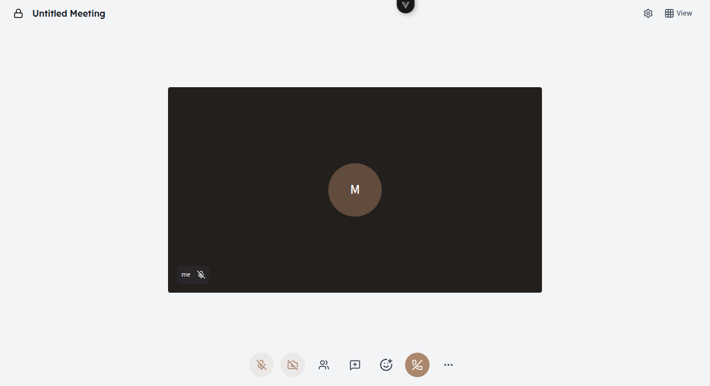
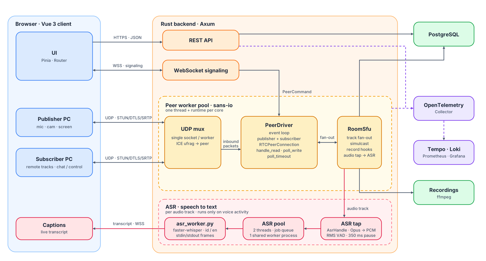

<a id="readme-top"></a>

<div align="center">
  <h1>Orvix</h1>

  <p>
    A self-hosted video conferencing platform built on a custom Rust SFU and a Vue 3 client.
    <br />
    Own your meetings, your media, and your data.
  </p>

  <p>
    <a href="docs/md/index.md"><strong>Read the Docs</strong></a>
    &middot;
    <a href="https://github.com/marfanr/vidcall/issues/new?labels=bug"><strong>Report Bug</strong></a>
    &middot;
    <a href="https://github.com/marfanr/vidcall/issues/new?labels=enhancement"><strong>Request Feature</strong></a>
  </p>

  
  
  

  <br /><br />

  
  
  
  
  
  
  
  
</div>

<br />

<div align="center">
  
</div>

## About

**Orvix** is a self-hosted video conferencing system for teams that want full control over their meetings. A Rust backend with a purpose-built Selective Forwarding Unit (SFU) handles WebRTC media, authentication, and rooms, while a Vue 3 frontend provides the meeting experience. Media flows through your own infrastructure, with no third-party service involved.

## Features

- **Video & audio:** multi-party calls through a custom sans-io Rust SFU with simulcast-aware forwarding.
- **Meeting rooms:** aliases, optional passcodes, custom titles, and a waiting room with join requests.
- **In-call tools:** chat, emoji reactions, screen sharing, member list, and per-device media configuration.
- **Authentication:** JWT access tokens with rotating refresh tokens and reuse detection.
- **Recording:** server-side recording to disk (requires `ffmpeg`).
- **Speech-to-text:** local transcription powered by [pywhispercpp](https://github.com/absadiki/pywhispercpp).
- **Text-to-speech:** local voices powered by [Kokoro-82M](https://huggingface.co/hexgrad/Kokoro-82M) (Apache-2.0), with G2P via [misaki](https://github.com/hexgrad/misaki).
- **AI assistant:** an in-meeting agent powered by [rig-core](https://github.com/0xPlaygrounds/rig) for model access and [graph-flow](https://github.com/a-agmon/rs-graph-llm) for multi-step task orchestration; invite it from the call controls.
- **Background blur:** runs in the browser via [MediaPipe](https://ai.google.dev/edge/mediapipe/solutions/vision/image_segmenter).
- **Observability:** OpenTelemetry, Prometheus, Loki, Tempo, and provisioned Grafana dashboards.

## Architecture


For SFU internals, API reference, data models, and the full environment variable list, see the [documentation](docs/md/index.md).

The backend is a Cargo workspace under `backend/crates`:

| Crate     | Responsibility                                                        |
| --------- | --------------------------------------------------------------------- |
| `common`  | Logging, telemetry, database tracing, JWT and config helpers          |
| `models`  | PostgreSQL models and connection pool                                 |
| `ai`      | Speech-to-text, text-to-speech, and the LLM agent runtime (rig-core + graph-flow) |
| `media`   | SFU, WebRTC peer, recording, and the AI room assistant                |
| `api`     | HTTP routes, authentication, metrics, and WebSocket signaling         |
| `server`  | Binary entry point (`cargo run` defaults to this crate)               |

Build only what you need, for example `cargo check -p models` or `cargo check -p api`.

The assistant is an in-meeting agent rather than a normal participant. `media` spawns it when someone sends `invite_ai` over the control data channel, and `ai` executes its work: `rig-core` provides the model client for any OpenAI-compatible endpoint configured through `LLM_*`, while `graph-flow` models the agent's tasks, edges, and session state as a graph.

<p align="right">(<a href="#readme-top">back to top</a>)</p>

## Getting Started

### Prerequisites

- Rust 1.85+
- Bun 1.2+ (or Node.js 22.18+ / 24.12+)
- Docker and Docker Compose
- OpenSSL
- FFmpeg (optional, for recording)
- Python 3.9+ (optional, for the local speech-to-text worker)

### Installation

1. Clone the repository:

   ```sh
   git clone git@github.com:marfanr/vidcall.git
   cd vidcall
   ```

2. Generate TLS certificates and the base environment file:

   ```sh
   cd backend
   ./setup_certs.sh
   ```

3. Add the JWT secrets to `backend/.env` (each at least 32 bytes, and different from each other):

   ```sh
   openssl rand -base64 48   # JWT_ACCESS_SECRET
   openssl rand -base64 48   # JWT_REFRESH_SECRET
   ```

   Then fill in `POSTGRES_PASSWORD`, `ADMIN_PASSWORD`, and `REPLICATION_PASSWORD` as described in [Environment variables](#environment-variables). The TLS entries are written by `setup_certs.sh` automatically.

4. Start PostgreSQL and apply the database migrations:

   ```sh
   docker compose up -d etcd postgres db-init
   ```

   The `db-init` service waits for the primary, creates the `vidcall` database if it does not exist, and applies [`backend/migrations/01-init.sql`](backend/migrations/01-init.sql). See [Database migrations](#database-migrations) for manual and incremental migration steps.

   Optionally start the observability stack:

   ```sh
   docker compose up -d otel-collector tempo loki prometheus grafana
   ```

5. (Optional) Verify the schema:

   ```sh
   docker exec postgres psql -U postgres -d vidcall -c '\dt'
   ```

   You should see the `users`, `refresh_tokens`, and `room` tables.

6. Set up the Python environment for the local speech-to-text worker:

   ```sh
   cd backend
   python3 -m venv .venv
   source .venv/bin/activate
   pip install uv
   pip install -r requirements.txt
   GGML_VULKAN=1 uv pip install --force-reinstall git+https://github.com/absadiki/pywhispercpp
   ```

   `GGML_VULKAN=1` builds pywhispercpp with the Vulkan backend; drop it for a CPU-only build. The Whisper model is downloaded automatically on first run. Set `WHISPER_DOWNLOAD_ROOT` to control where models are cached.

### Environment variables

The backend loads `backend/.env` at startup. `setup_certs.sh` creates the file and fills the TLS entries, so you only need to add the secrets by hand.

| Variable | Required | Default | Purpose |
| --- | --- | --- | --- |
| `POSTGRES_PASSWORD` | Yes | — | Password for the `postgres` superuser. Read by the backend and the database containers. |
| `ADMIN_PASSWORD` | Yes (compose) | — | Password for the `admin` database role created by Spilo. Only used by `docker-compose.yml`. |
| `REPLICATION_PASSWORD` | Yes (compose) | — | Password for the `standby` replication role created by Spilo. Only used by `docker-compose.yml`. |
| `DATABASE_URL` | No | — | Convenience string for external clients. The backend ignores it and connects from the `POSTGRES_*` settings instead. |
| `JWT_ACCESS_SECRET` | Yes | — | HMAC key for access tokens. Must be at least 32 bytes. |
| `JWT_REFRESH_SECRET` | Yes | — | HMAC key for refresh tokens. Must be at least 32 bytes and differ from the access secret. |
| `SSL_CERTIFICATE` | Yes (compose) | — | PEM server certificate handed to Postgres, with literal `\n` line breaks. |
| `SSL_PRIVATE_KEY` | Yes (compose) | — | PEM private key matching `SSL_CERTIFICATE`. |
| `PG_CA_CERT` | No | `certs/ca.crt` | CA bundle the backend uses to verify the Postgres TLS connection. |
| `LLM_TOKEN` | No | — | Token for the AI assistant's OpenAI-compatible provider. |
| `LLM_PROVIDER` | No | — | Label for the provider; informational only. |
| `LLM_URL` | No | — | Base URL of the OpenAI-compatible API. |
| `LLM_MODEL` | No | — | Model name passed to the provider. |

Generate the secrets with:

```sh
openssl rand -hex 32    # POSTGRES_PASSWORD, ADMIN_PASSWORD, REPLICATION_PASSWORD
openssl rand -base64 48 # JWT_ACCESS_SECRET
openssl rand -base64 48 # JWT_REFRESH_SECRET
```

The backend refuses to start when either JWT secret is missing, shorter than 32 bytes, or identical to the other. Connection settings (`POSTGRES_HOST`, `POSTGRES_PORT`, `POSTGRES_DB`, `POSTGRES_USER`, `POSTGRES_POOL_SIZE`) default to `localhost`, `5432`, `vidcall`, `postgres`, and `32`; they do not need to be in `.env` for a local setup.

### Run

```sh
# backend (http://localhost:8080)
cd backend && cargo run

# frontend (http://localhost:5173)
cd frontend && bun install && bun dev
```

<p align="right">(<a href="#readme-top">back to top</a>)</p>

## Roadmap

- [x] Multi-party WebRTC SFU
- [x] JWT authentication with rotating refresh tokens
- [x] Waiting room and join requests
- [x] Chat, reactions, and screen sharing
- [x] Server-side recording
- [ ] End-to-end encrypted media
- [ ] Horizontal SFU scaling for large rooms
- [ ] docker image for production ready

See the [open issues](https://github.com/marfanr/vidcall/issues) for proposed features and known issues.

## Contributing

Contributions are welcome. Fork the project, create a feature branch, and open a pull request. Before submitting, run:

```sh
# frontend
cd frontend && bun run type-check && bun run lint

# backend
cd backend && cargo fmt --check && cargo clippy --all-targets -- -D warnings && cargo test
```

## License

The source code is distributed under the **GNU Affero General Public License v3.0 (AGPL-3.0)**. See [`LICENSE`](LICENSE) for details.

Third-party assets keep their own licenses and are not covered by the AGPL-3.0:

- [`models/kokoro/`](models/kokoro/) contains the **Kokoro-82M** model weights, tokenizer, and voice embeddings, licensed under **Apache-2.0**. See [`models/kokoro/LICENSE.md`](models/kokoro/LICENSE.md) and [`models/kokoro/NOTICE`](models/kokoro/NOTICE). The model is not affiliated with or endorsed by hexgrad.

## Acknowledgments

[webrtc-rs/rtc](https://github.com/webrtc-rs/rtc), [Axum](https://github.com/tokio-rs/axum) and Tokio, [Vue.js](https://vuejs.org/), [OpenTelemetry](https://opentelemetry.io/), [Grafana](https://grafana.com/), [ONNX Runtime](https://onnxruntime.ai/), [MediaPipe](https://developers.google.com/mediapipe), [Kokoro-82M](https://huggingface.co/hexgrad/Kokoro-82M), [misaki](https://github.com/hexgrad/misaki), [kokoro-onnx](https://github.com/thewh1teagle/kokoro-onnx), [rig](https://github.com/0xPlaygrounds/rig), [graph-flow](https://github.com/a-agmon/rs-graph-llm), and [Best-README-Template](https://github.com/othneildrew/Best-README-Template).

<p align="right">(<a href="#readme-top">back to top</a>)</p>
